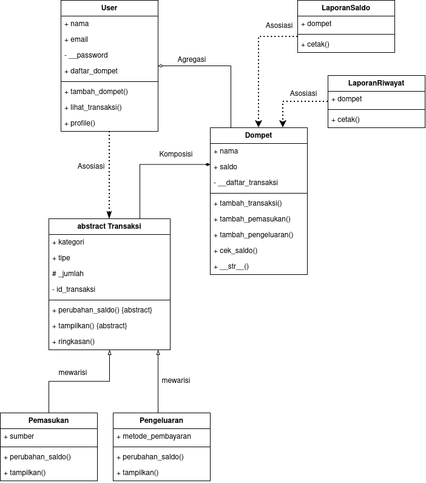
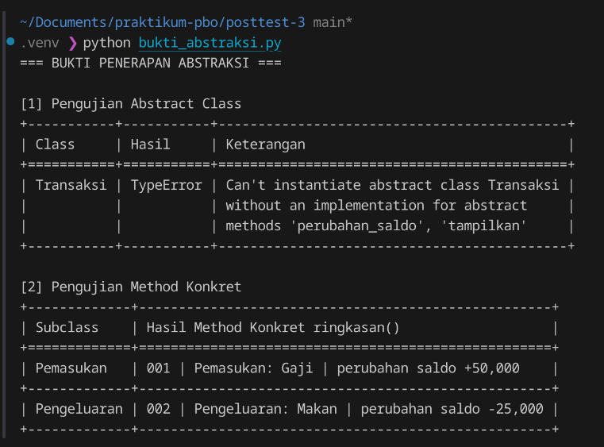
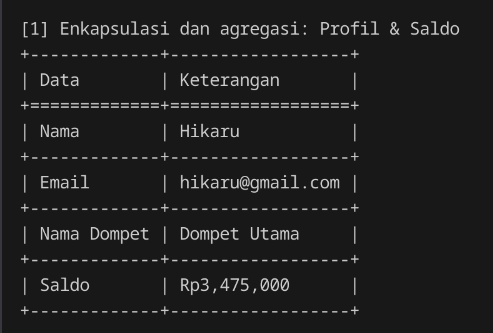
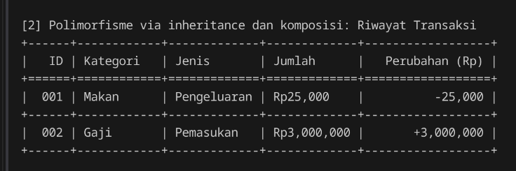
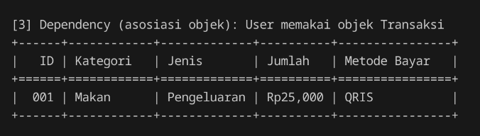
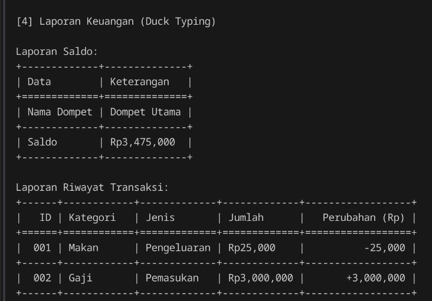

# Posttest 3 — Sistem Manajemen Keuangan

## Deskripsi Program

Sistem Manajemen Keuangan merupakan aplikasi berbasis Python yang digunakan untuk mengelola dompet digital, mencatat pemasukan dan pengeluaran, serta menampilkan saldo dan riwayat transaksi.

Program ini dikembangkan menggunakan konsep **Object-Oriented Programming (OOP)**, dengan fokus pada penerapan **abstraksi, polimorfisme, dan relasi antarkelas**. Program juga menerapkan enkapsulasi, inheritance, operator overloading, serta salah satu prinsip SOLID, yaitu **Open/Closed Principle (OCP)**.

## 1. Struktur Program

Program terdiri dari beberapa file utama:

| File | Fungsi |
|---|---|
| `user.py` | Mengelola data pengguna dan hubungan pengguna dengan dompet. |
| `dompet.py` | Mengelola saldo, pencatatan transaksi, dan riwayat transaksi. |
| `transaksi.py` | Mendefinisikan abstract class `Transaksi` beserta subclass `Pemasukan` dan `Pengeluaran`. |
| `laporan.py` | Menampilkan laporan saldo dan riwayat transaksi menggunakan duck typing. |
| `main.py` | Menjalankan program dan menghubungkan seluruh class. |

## 2. Class Diagram dan Relasi UML

Class Diagram menggambarkan struktur kelas beserta hubungan antarkelas dalam program Sistem Manajemen Keuangan.

### 2.1 Asosiasi (Association)

**Relasi: `LaporanSaldo` — `Dompet` dan `LaporanRiwayat` — `Dompet`**

Relasi asosiasi diterapkan karena kedua class laporan menggunakan objek `Dompet` untuk mengakses informasi keuangan melalui atribut `self.dompet`. Kedua class laporan tidak bertanggung jawab membuat maupun mengelola siklus hidup objek dompet.

Implementasinya terdapat pada constructor `__init__(self, dompet)` di file `laporan.py`.

### 2.2 Agregasi (Aggregation)

**Relasi: `User` ◇—— `Dompet`**

Relasi agregasi diterapkan karena satu `User` dapat memiliki beberapa objek `Dompet` yang dibuat secara terpisah. Objek `Dompet` tetap dapat digunakan secara independen meskipun tidak lagi menjadi bagian dari daftar dompet milik `User`.

Implementasinya terdapat pada method `tambah_dompet()` di file `user.py`, yang menyimpan referensi objek dompet melalui `self.daftar_dompet.append(dompet)`.

### 2.3 Komposisi (Composition)

**Relasi: `Dompet` ◆—— `Transaksi`**

Relasi komposisi digunakan karena transaksi dicatat sebagai bagian dari pengelolaan keuangan suatu dompet. Class `Dompet` bertanggung jawab membuat, memvalidasi, dan menyimpan transaksi melalui method `tambah_transaksi()`.

Implementasinya terdapat pada file `dompet.py`, ketika objek dibuat menggunakan `kelas_transaksi(...)` kemudian disimpan melalui `self.__daftar_transaksi.append(transaksi)`.

Hubungan ini menggambarkan kepemilikan transaksi dalam desain aplikasi, meskipun Python tetap memungkinkan referensi objek transaksi disimpan di luar dompet.

### 2.4 Inheritance

**Relasi: `Transaksi` — `Pemasukan` dan `Pengeluaran`**

Class `Pemasukan` dan `Pengeluaran` merupakan subclass dari `Transaksi`. Keduanya mewarisi atribut dan method dari class induk, serta memiliki atribut dan implementasi method yang berbeda sesuai jenis transaksi.

## 3. Penerapan Abstraksi (Abstract Base Class)

Abstraksi diterapkan pada file `transaksi.py` menggunakan `ABC` dan `abstractmethod` dari modul `abc` Python.

Class `Transaksi` didefinisikan sebagai abstract class yang menjadi dasar bagi berbagai jenis transaksi.

### 3.1 Abstract Method

Class `Transaksi` memiliki dua abstract method:

1. `perubahan_saldo()` — menentukan perubahan saldo berdasarkan perilaku setiap jenis transaksi.
2. `tampilkan()` — menampilkan informasi transaksi.

Kedua method menggunakan dekorator `@abstractmethod`, sehingga subclass konkret wajib mengimplementasikannya sebelum dapat dibuat menjadi objek.

### 3.2 Implementasi Abstract Method pada Subclass

**Class `Pemasukan`**

- Menggunakan `super().__init__()` untuk memanggil constructor class induk.
- Memiliki atribut khusus `sumber`.
- Mengimplementasikan `perubahan_saldo()` dengan mengembalikan nilai positif.
- Mengimplementasikan `tampilkan()` untuk menampilkan informasi pemasukan, termasuk sumbernya.

**Class `Pengeluaran`**

- Menggunakan `super().__init__()` untuk memanggil constructor class induk.
- Memiliki atribut khusus `metode_pembayaran`.
- Mengimplementasikan `perubahan_saldo()` dengan mengembalikan nilai negatif.
- Mengimplementasikan `tampilkan()` untuk menampilkan informasi pengeluaran, termasuk metode pembayarannya.

Dengan demikian, kedua subclass memiliki implementasi seluruh abstract method yang diwajibkan oleh `Transaksi`.

### 3.3 Method Konkret

Selain abstract method, class `Transaksi` memiliki method konkret `ringkasan()`.

Method ini menghasilkan informasi ringkas berupa ID transaksi, jenis transaksi, kategori, dan perubahan saldo.

Method `ringkasan()` dapat digunakan bersama oleh `Pemasukan` dan `Pengeluaran` tanpa perlu di-override karena implementasinya sudah tersedia pada class induk.

Di dalam method tersebut terdapat pemanggilan `self.perubahan_saldo()`, sehingga hasil ringkasan menyesuaikan perilaku subclass masing-masing.

### 3.4 Bukti Penerapan Abstraksi

Pengujian abstraksi dilakukan melalui file `bukti_abstraksi.py` dengan dua pengujian.

**1. Pengujian Abstract Class**

Program mencoba membuat objek langsung dari class `Transaksi`. Pengujian menghasilkan `TypeError` karena class `Transaksi` merupakan abstract class yang memiliki dua abstract method, yaitu `perubahan_saldo()` dan `tampilkan()`.

**2. Pengujian Method Konkret**

Pengujian dilakukan dengan memanggil method `ringkasan()` melalui objek `Pemasukan` dan `Pengeluaran` dalam satu perulangan.

Kedua subclass menggunakan method konkret yang sama dari class induk `Transaksi`, tetapi menghasilkan ringkasan berbeda karena implementasi `perubahan_saldo()` pada masing-masing subclass.

Hasil tersebut membuktikan bahwa method konkret dapat diwariskan dan digunakan bersama oleh subclass.

**Screenshot Hasil Pengujian:**

## 4. Penerapan Polimorfisme

Polimorfisme memungkinkan objek dari class yang berbeda merespons pemanggilan method yang sama dengan perilaku yang berbeda.

Program menerapkan polimorfisme melalui inheritance dan duck typing.

### 4.1 Polimorfisme melalui Pewarisan (Method Overriding)

**Lokasi: `transaksi.py`, `dompet.py`, dan `main.py`**

Polimorfisme melalui inheritance diterapkan pada subclass `Pemasukan` dan `Pengeluaran` yang melakukan overriding terhadap method `perubahan_saldo()` dan `tampilkan()`.

Method `perubahan_saldo()` memiliki perilaku berbeda pada setiap subclass:

- `Pemasukan` menghasilkan perubahan saldo positif.
- `Pengeluaran` menghasilkan perubahan saldo negatif.

Pada `main.py`, objek dari kedua subclass diproses melalui satu perulangan yang memanggil `transaksi.perubahan_saldo()`.

Python menjalankan implementasi method berdasarkan class dari objek yang sedang diproses, sehingga tidak diperlukan pengecekan jenis transaksi menggunakan `type()` maupun rantai `if/elif`.

### 4.2 Duck Typing

**Lokasi: `laporan.py` dan `main.py`**

Duck typing diterapkan menggunakan dua class yang tidak memiliki hubungan pewarisan, yaitu `LaporanSaldo` dan `LaporanRiwayat`.

Kedua class memiliki method dengan nama yang sama, yaitu `cetak()`, tetapi menghasilkan keluaran berbeda:

- `LaporanSaldo.cetak()` menampilkan tabel nama dompet dan saldo.
- `LaporanRiwayat.cetak()` menampilkan tabel riwayat transaksi.

Kedua objek dapat diproses menggunakan fungsi `cetak_laporan(laporan)` yang memanggil `laporan.cetak()` tanpa memeriksa jenis class objek.

Pada `main.py`, objek `LaporanSaldo` dan `LaporanRiwayat` dipanggil melalui satu perulangan menggunakan fungsi tersebut.

Dengan demikian, objek dapat digunakan berdasarkan method yang dimilikinya, tanpa harus memiliki hubungan inheritance.

### 4.3 Operator Overloading

**Lokasi: `dompet.py`**

Operator overloading diterapkan melalui magic method `__str__()` pada class `Dompet`.

Method ini menentukan representasi string objek ketika dipanggil menggunakan `str()` atau `print()`.

Contoh representasi objek:

`Dompet 'Dompet Utama' (saldo: Rp3,475,000)`

Implementasi ini membuat informasi objek dompet lebih mudah dibaca dibandingkan representasi bawaan Python.

## 5. Penerapan Enkapsulasi dan Inheritance

Program mempertahankan konsep enkapsulasi dan inheritance yang telah diterapkan pada posttest sebelumnya.

### 5.1 Inheritance

Class `Pemasukan` dan `Pengeluaran` mewarisi atribut dan method dari class `Transaksi`.

Kedua subclass menggunakan `super().__init__(...)` untuk menginisialisasi atribut dari class induk, serta menambahkan atribut khusus sesuai kebutuhan transaksi masing-masing.

### 5.2 Protected dan Private Attribute

Contoh penerapan protected dan private attribute:

| Class | Atribut | Akses |
|---|---|---|
| `Transaksi` | `_jumlah` | Protected |
| `Transaksi` | `__id_transaksi` | Private |
| `Dompet` | `__saldo` | Private |
| `Dompet` | `__daftar_transaksi` | Private |
| `User` | `__password` | Private |

Pengaksesan dan perubahan beberapa atribut dikendalikan melalui `@property` dan setter.

Contohnya, setter `jumlah` menolak nominal transaksi yang tidak lebih besar dari nol, sedangkan setter `saldo` menolak saldo negatif.

## 6. Penerapan Prinsip SOLID (Nilai Tambahan)

### Open/Closed Principle (OCP)

**Lokasi: `dompet.py`, method `tambah_transaksi()`**

Open/Closed Principle menyatakan bahwa komponen program sebaiknya terbuka untuk pengembangan, tetapi tidak memerlukan perubahan terhadap logika yang telah ada setiap kali fitur baru ditambahkan.

Dalam program ini, method `tambah_transaksi()` menerima class transaksi melalui parameter `kelas_transaksi`.

Method tersebut membuat objek transaksi dan memanggil `transaksi.perubahan_saldo()` tanpa melakukan pengecekan apakah objek berasal dari class `Pemasukan` atau `Pengeluaran`.

Sebagai contoh pengembangan, subclass baru seperti `Cashback` dapat ditambahkan dengan mewarisi `Transaksi` dan mengimplementasikan abstract method yang diwajibkan.

Selama subclass baru mengikuti kontrak dan parameter constructor yang digunakan, objeknya dapat diproses melalui `tambah_transaksi()` tanpa mengubah logika utama pencatatan transaksi pada class `Dompet`.

Dengan demikian, penerapan OCP membuat program lebih mudah dikembangkan ketika terdapat jenis transaksi baru.

## 7. Hasil Eksekusi Program

### 7.1 Profil dan Saldo

### 7.2 Riwayat Transaksi

### 7.3 Detail Pengeluaran

### 7.4 Laporan Keuangan (Duck Typing)

### 7.5 Bukti Pengujian Abstraksi

## 8. Cara Menjalankan Program

Pastikan Python telah terpasang pada perangkat.

**1. Instal library yang dibutuhkan**

`pip install tabulate`

**2. Jalankan program utama**

`python main.py`

**3. Jalankan pengujian abstraksi**

`python bukti_abstraksi.py`

## 9. Kesimpulan

Program Sistem Manajemen Keuangan telah menerapkan konsep abstraksi dan polimorfisme untuk memisahkan tanggung jawab antarkelas dan memungkinkan objek dengan perilaku berbeda digunakan melalui antarmuka method yang sama.

Abstraksi diterapkan pada class `Transaksi`, polimorfisme melalui overriding diterapkan pada `Pemasukan` dan `Pengeluaran`, sedangkan duck typing diterapkan pada class `LaporanSaldo` dan `LaporanRiwayat`.

Program juga menerapkan relasi asosiasi, agregasi, komposisi, inheritance, enkapsulasi, operator overloading, serta prinsip SOLID Open/Closed Principle untuk mendukung pengembangan program tanpa harus mengubah logika utama yang sudah ada.
